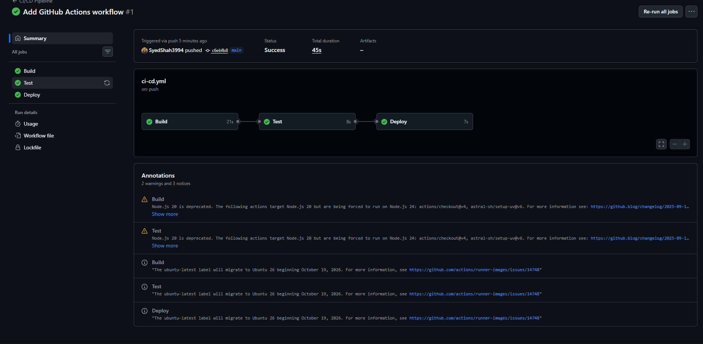
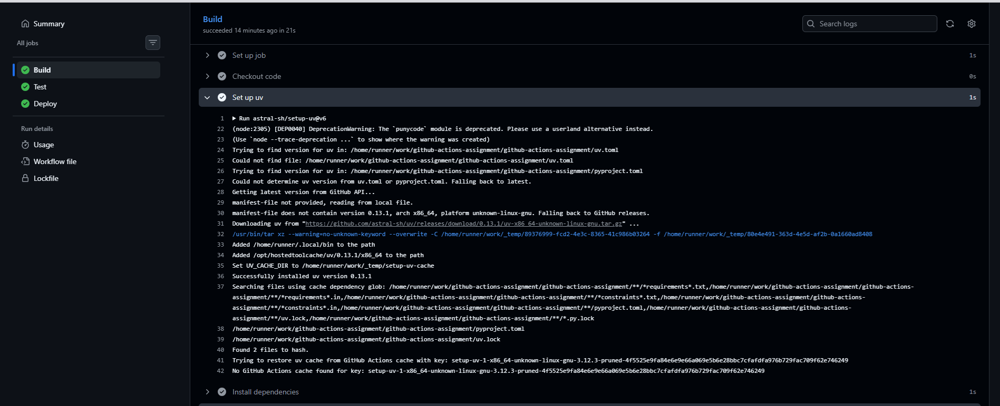
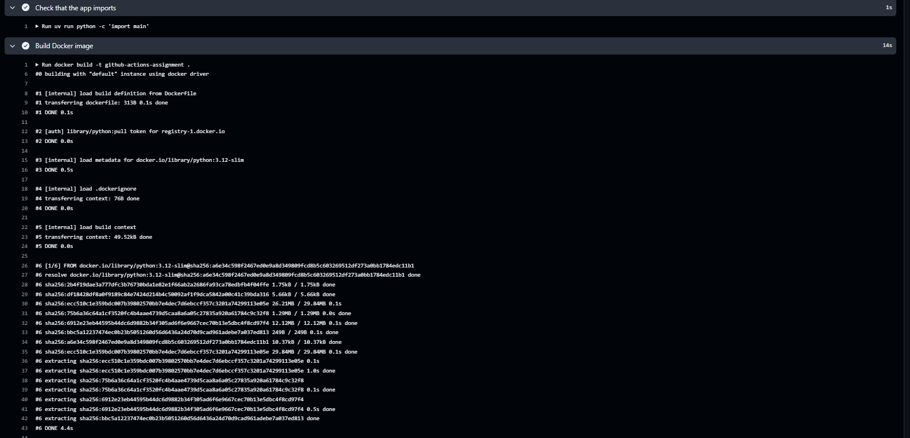
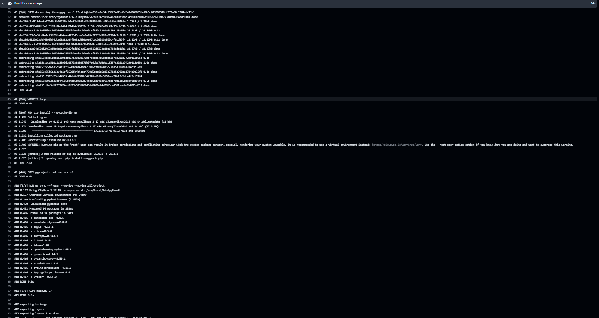
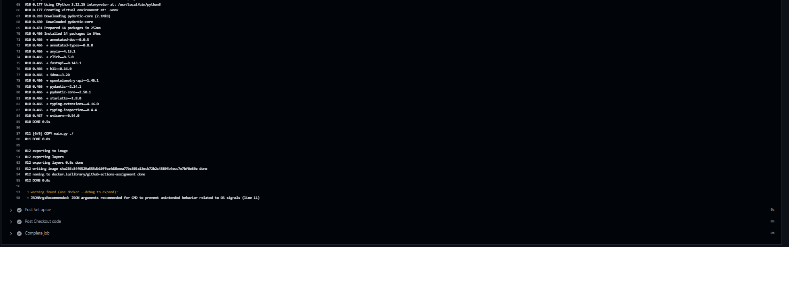
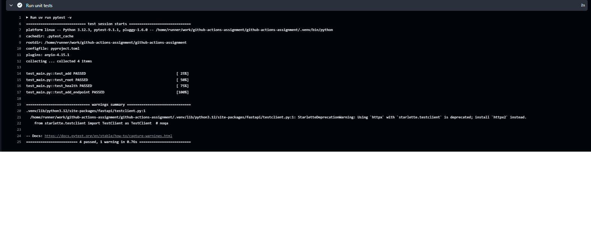
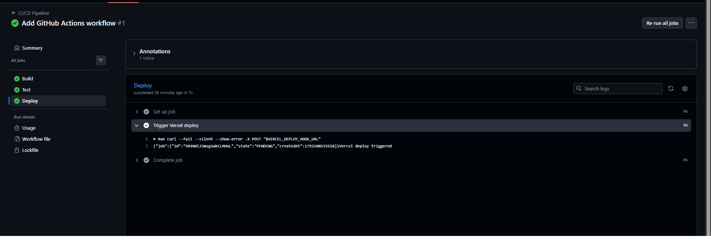
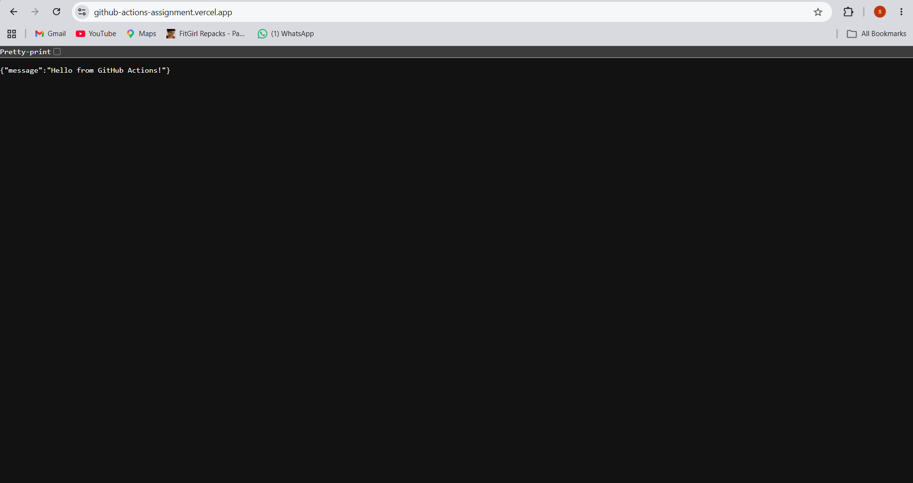

# GitHub Actions CI/CD Assignment

## Application

A small FastAPI web application with three endpoints: `/` (welcome message),
`/health` (health check) and `/add` (adds two numbers). The project is
managed with uv and has unit tests written with pytest.

Live URL: https://github-actions-assignment.vercel.app

## Workflow

The workflow file is `.github/workflows/ci-cd.yml`. It runs on every push to
the `main` branch, on GitHub's public runners (`ubuntu-latest`), and has
three jobs:

1. **Build:** checks out the code, installs uv and the dependencies, checks
   that the app imports, and builds the Docker image.
2. **Test:** runs after Build succeeds and runs the unit tests with `uv run
   pytest -v`.
3. **Deploy:** runs only after Test succeeds and triggers a deployment on
   Vercel by calling the Vercel Deploy Hook with `curl`.

## Secrets

The Vercel Deploy Hook URL is sensitive, so it is stored as the GitHub
Actions secret `VERCEL_DEPLOY_HOOK_URL` and passed to the job as an
environment variable. It is never written in the code.

## Screenshots

### Workflow run

### Build job

### Test job

### Deploy job

### Application running on Vercel

